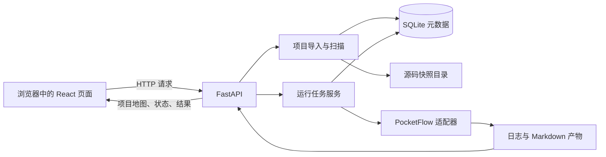

# RepoLens 系统架构与数据保存方案

> 状态：M1–M5已实施（2026-09-22）；PocketFlow配方驱动表单和macOS隔离运行已接通。配合[页面蓝图](01-product-blueprint.md)和[实施路线](02-delivery-roadmap.md)使用。

具体开发任务和可复制提示词见 [00 创作总指南](00-creation-guide.md)：步骤 4–5 接数据库和真实地图，步骤 6–7 接运行任务。版本管理见 [04 Git 操作手册](04-git-workflow.md)。

## 1. 三个层面分别是什么

| 层面 | 负责的事 | 首版位置 |
|---|---|---|
| 页面和前端 | 展示项目地图、证据卡、参数表单、运行状态；把点击操作变成 API 请求 | `web/`，React + TypeScript |
| 后台服务 | 导入仓库、扫描文件、生成职责卡、校验参数、创建任务、调用 PocketFlow、提供结果 | `server/`，Python FastAPI |
| 数据与文件 | 保存项目、快照、卡片、证据和运行索引；保存实际源码、日志与 Markdown | `var/repolens.sqlite3` 加 `var/` 下的文件目录 |

React 是构建交互页面的工具，不是“中台”。此项目不另建一个独立中台；前端通过后台 API 获得项目数据和操作能力，后台把扫描、运行与保存组织起来。



前端模块：输入页负责选择来源；工作台组合文件夹地图、当前文件夹说明、固定运行窗口；API 客户端集中处理请求。后端模块：导入器只处理来源与快照，扫描器只生成文件和证据索引，运行器只处理任务生命周期，PocketFlow 适配器只负责把结构化参数转成已有程序能接受的参数。

## 2. 数据究竟保存在哪里

| 数据 | 保存位置 | 原因 |
|---|---|---|
| 项目名称、来源、Commit 或快照标识 | SQLite `projects`、`snapshots` | 支持项目列表、版本追踪和重新打开 |
| 文件夹职责卡、结论类型和源码引用 | SQLite `folder_cards`、`evidence_refs` | 可按项目和路径查询、更新、核对 |
| 任务参数、状态、开始/结束时间、退出码 | SQLite `runs` | 页面刷新后仍能查看运行历史 |
| 产物名称、类型、相对路径 | SQLite `artifacts` | 页面知道应读取哪个结果文件 |
| 上传或下载的仓库文件 | `var/snapshots/<snapshot-id>/` | 文件量和大小不适合直接塞入首版数据库 |
| 原始日志、Markdown 教程、导出文件 | `var/runs/<run-id>/` | 保留原始产物，便于检查与下载 |
| 人工挑选的验收截图与记录 | `evidence/` | 用于项目复盘和作品集，不是产品运行数据 |
| 模型/API 密钥 | 后台环境变量或本机密钥存储 | 不写入浏览器状态、数据库、日志或文档 |

SQLite 的数据库是本机文件，不需要另起一个数据库服务；FastAPI 官方示例也使用 SQLite 演示单文件数据库。[SQLite 官方说明](https://www.sqlite.org/onefile.html)、[FastAPI 数据库教程](https://fastapi.tiangolo.com/tutorial/sql-databases/)。首版只面向本地单用户；若将来需要多人并发和云端部署，再评估 PostgreSQL 与对象存储，不在 M1 添加这些依赖。

## 3. 什么时候接数据库

- **M1 页面样稿：**使用明确标识的演示数据，存在 `web/src/demo/`；只有页面交互，不创建数据库。
- **M2 真实仓库地图：**同时建立 `server/` 和 SQLite。导入完成后先形成来源快照，再写入项目、文件夹卡和证据索引；刷新页面可重新打开项目。
- **M3 页面运行 PocketFlow：**复用同一 SQLite，新增运行记录和产物索引；原始日志与 Markdown 留在 `var/runs/`。
- **M4 及以后：**复用项目与快照标识做缓存、去重和版本对比。数据量和多人使用确实需要时才迁移数据库。

因此不需要“把所有页面做好后再接数据库”：页面外观先做，第一项真实数据功能开始时就接。也不需要在 M1 为静态演示配置数据库。

## 4. 一次操作怎样流转

1. 用户从页面打开内置 PocketFlow 示例，或主动选择本地目录。浏览器目录选择只提供文件和相对路径，后台把上传内容放进独立快照；浏览器不会得到用户电脑的绝对路径。[MDN 目录选择说明](https://developer.mozilla.org/en-US/docs/Web/API/HTMLInputElement/webkitdirectory)。
2. 后台扫描快照，写入 `projects`、`snapshots`、`folder_cards`、`evidence_refs`。页面请求项目详情并画出文件夹地图。内置示例可从其 Git 仓库获取 Commit；普通上传使用内容快照标识。
3. 用户在运行窗口填写参数并点击“生成项目导览”。后台校验参数，先插入一条 `runs` 记录，再启动固定进程（真实PocketFlow或无模型替身）。
4. 运行中，后台更新任务状态、阶段和日志文件；页面轮询状态。成功后，后台登记 `index.md` 等产物到 `artifacts`，页面预览结果。
5. 页面刷新后仍从 SQLite 找到项目、运行历史和产物路径；若文件已经丢失，显示“产物缺失”，不把记录当成成功结果。

## 5. 接口与目录约定

首版接口约定：`GET /api/projects` 列项目；`POST /api/projects/import` 导入快照；`GET /api/projects/{id}` 取地图与证据；`POST /api/runs` 创建已登记的操作；`GET /api/runs/{id}` 取状态与结果。实际开发时保持页面与后台的数据类型一致。

```text
RepoLens/
├── docs/                    产品设计、实施路线、系统架构、视觉样稿
├── web/                     React 演示页面（M1 步骤 2 已创建）
├── server/                  FastAPI 与数据操作（M2 步骤 4 已创建）
├── upstream/                上游参考项目快照
├── notes/                   静态研究笔记
├── evidence/                人工验收证据
└── var/                     运行数据（M2 步骤 4 已创建，不进入版本库）
    ├── repolens.sqlite3
    ├── snapshots/<snapshot-id>/
    └── runs/<run-id>/
```

项目根目录将是以后开发的统一工作区。产品源代码只进入 `web/` 和 `server/`；上游参考代码保持在 `upstream/`。文档决策写在 `docs/`，实际运行数据写在 `var/`，人工验证留在 `evidence/`。

## 6. 页面视觉方向

视觉样稿位于[可切换的概念页](mockups/01-workbench-concept.html)；也可直接看[输入页截图](mockups/01-home-concept.png)和[工作台截图](mockups/01-workbench-concept.png)。它只展示视觉和基本页面切换，不调用后台，也不代表 M1 已完成。

- 首页延续 GitDiagram 的集中输入方式；进入项目后使用清楚的三栏工作台。左侧导航、中间解释、右侧操作，屏幕上始终有一个明确的主要动作。
- 用偏暖的浅色背景、深色文字、少量青绿色强调、宽松留白和统一卡片边框。运行进度、证据类型和主按钮用颜色辅助识别，文字标签始终保留。
- 项目架构先以“文件夹地图 + 六阶段流程”两种视图呈现。节点或文件夹可点击；详细源码藏在逐层展开的卡片里，避免一打开就堆满代码。
- 首页、空状态、扫描中、成功、失败分别设计；M1 样稿数据明确标“演示”，真实能力接通后才把按钮变为可用。

这个视觉方向是 RepoLens 自己的界面，不直接复制 PocketFlow 的命令行输出或其他产品的视觉资产。

## 7. M2 步骤 4 的落地约定

- `server/app/models.py` 定义项目、快照、文件夹卡和证据类型；`repository.py` 使用标准库 sqlite3 参数绑定、外键和事务保存，不引入 ORM。
- 迁移在 `server/migrations/`，历史版本、文件名和 SHA-256 写入 `schema_migrations`；启动前校验并执行，失败回滚。数据库固定默认位置 `var/repolens.sqlite3`，不会随工作目录变化。
- 当前实际接口为 `GET /api/health`、`GET /api/projects`、`GET /api/projects/{project_id}`。请求与响应字段见 [后台 README](../server/README.md)。当前返回所有快照的嵌套元数据，不包含源码树或文件内容 API。
- 项目来源、卡片结论类型、相对路径和快照关系已建模；证据提取和事实核验仍由下一步扫描器负责。内部保存函数不执行源码、不访问远程仓库。
- 默认数据库为空；合成持久化测试数据独立放在 `var/tests/` 并在测试结束清理。运行表和产物表按 M3 追加迁移，不提前创建空功能。

## 8. M2 步骤 5 的落地约定

- 当前 `POST /api/projects/import` 接受 `builtin` 或 `upload`。内置读取固定 Git HEAD 的普通 blob，上传使用受限 JSON + Base64 和相对路径；不执行项目或读取任意主机路径。内容复制到独立 UUID 快照，再一次事务保存元数据。
- 版本 002 新增 `snapshot_files`（路径、字节数、SHA-256）和卡片 `inference` 字段。真实目录来自过滤后的快照，Python 定义、入口条件和连接表达式由 AST 提取；README／配置保留原文片段。名称推断与事实分别展示，无证据的职责保留待核实。
- `GET /api/snapshots/{id}/source` 只读已登记文件，检查相对路径、链接和 SHA-256，分页返回带行号文本；修改或丢失的快照返回 409。
- React 在 `#/projects/<id>` 通过 API 读回，首页列 SQLite 中的项目；演示入口 `#/workspace` 独立保留。Vite 本机代理 `/api` 到后台。
- 限制与请求字段见 [后台 README](../server/README.md)，实际验收见 [M2 记录](../evidence/m2/acceptance.md)。此处描述M2地图；运行任务已在M3补齐，GitHub远程下载已在M4补齐，完整符号图仍未实现。


## 9. M3 步骤 6–7 的落地约定

- 版本 003 新增 `runs`、`artifacts`；运行来源关联已登记 snapshot_id，范围限定已有目录。启动前检查字节数和 SHA-256，复制到运行目录作为只读分析输入，不执行上传源码。
- `Runner` 使用固定参数数组启动监督进程和对应模式子进程，独立cwd／HOME／环境。真实模式通过 `server/pocketflow/worker.py` 调用固定上游main.py，隔离环境位于 `server/pocketflow/.venv/`，不修改上游源码；密钥从显式配置读取后仅通过stdin传递。迁移004追加实际模型、提示词版本与用量。
- 运行状态、阶段、参数和索引在 SQLite；日志与 Markdown 在 `var/runs/`。取消停止进程组，后台重启将遗留活动任务标记 interrupted，不续跑。成功状态与产物登记在同一事务中提交。
- React 轮询任务和增量日志，刷新后重开历史。Markdown 禁止原始 HTML，外部图片不加载，章节只允许切换本次已登记产物。下载与读取都核对内容哈希。
- 职责提示词在 `server/app/prompts/` 版本管理；引用检查同一快照的文件、行号、原文。匹配也只标推断，不匹配标待核实，不覆盖原始事实。真实任务末尾调用版本化提示词，校验结果显示于页面；异常验证使用模拟响应，不消耗真实模型额度。
- M3当时是本机单进程、单活动任务，没有操作系统沙箱；M5为登记配方新增了macOS沙箱，仍无分布式队列。具体 API／配置见 [任务服务说明](07-task-runner.md)，真实证据见 [步骤7验收](../evidence/m3/acceptance.md)，固定输出历史见 [步骤6记录](../evidence/m3/step-6-check.md)。

## 10. M4 公开 GitHub 导入与缓存

- 首页创建持久化导入任务；后台只接受公开 `github.com/owner/repo` HTTPS 根地址，通过 GitHub API 解析默认分支当前 Commit，再下载该 Commit 的 codeload tar.gz。页面轮询阶段、百分比、固定版本和错误。
- GitHub解析／归档下载受30秒网络时限约束；归档另按压缩大小、条目、解包总量和保留文件数／大小约束。逐成员验证唯一根、相对路径、类型及冲突，从不执行仓库文件。规则见 [M4说明](09-github-import.md)。
- `github_sources + github_snapshot_cache` 是源码缓存：同仓库同 Commit 返回同一 snapshot；新 Commit 在同一 project 下新增 snapshot。`runs.result_cache_key` 是结果缓存：只有相同快照、模型、提示词和全部参数的成功真实结果才可复用，且复用前重验产物哈希。
- 地图扫描、源码证据和运行任务继续只接受登记的 snapshot_id；远程来源没有新增可执行入口。实际远程 PocketFlow、错误和版本变化见 [M4验收](../evidence/m4/acceptance.md)。

## 11. M5 已登记操作与隔离

- `recipes/definition.py` 定义不可变配方契约，`recipes/pocketflow.py` 声明首个真实入口、严格参数、依赖检查和产物；正式清单由产品代码维护。测试注册表可注入私有夹具，未增加第三方支持声明。
- `GET /api/recipes` 提供安全描述和就绪状态；React `RecipeFields` 从参数模式生成控件，创建请求只含配方ID、快照ID和参数。可信入口与用户快照始终分别管理。
- `isolation.py` 在macOS上以deny-default规则限制文件内容访问；输入只读，指定运行子目录可写，无法读取数据库和其他任务文件。自检失败拒绝启动；PocketFlow出站请求单独允许。
- 迁移006增加配方ID/版本、规范化参数JSON和隔离方式。旧记录不回填成M5沙箱记录；新模型结果缓存绑定配方版本与全部参数。
- 生命周期仍由Runner/监督进程管理；取消与超时清理受管进程组，保存退出码；收集前校验整个产物树。当前接入要求子进程不脱离进程组。完整边界与开发步骤见 [配方说明](10-action-recipes.md)，事实证据见 [M5验收](../evidence/m5/acceptance.md)。
