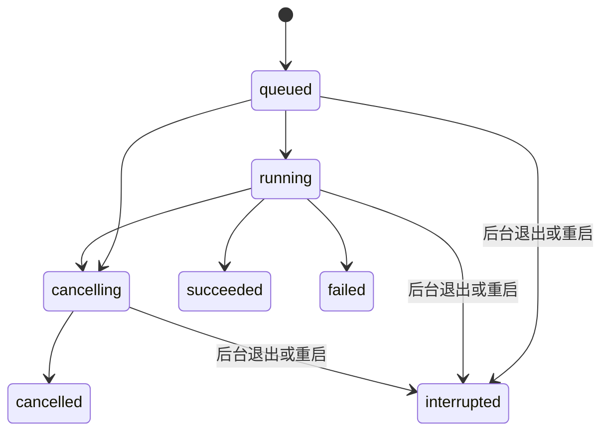

# M3：任务服务与实际配置

2026-09-21。支持明确区分的 **替身验证** 与 **真实 PocketFlow** 模式。步骤 7 的实际任务、截图和验收边界见 [验收记录](../evidence/m3/acceptance.md)。

## 1. 启动和操作

前后台启动命令见 [根 README](../README.md)。后台使用 `server/.venv`，PocketFlow 另有 `server/pocketflow/.venv`，安装、来源和版本见 [依赖说明](../server/pocketflow/README.md)。

1. 打开 http://127.0.0.1:5173/ ，扫描 PocketFlow 或打开已保存项目。
2. 默认选择替身模式，可选择已登记目录、中文／English、1–10 个主题，以及成功／失败／慢速情境；这些输出是固定测试内容。
3. 后台启用 `REPOLENS_ENABLE_REAL_RUN=1` 后，运行模式中可选“真实 PocketFlow”。只接受固定 Commit 的 PocketFlow 快照、`utils`、中文、1–3 个主题（页面提供1／3）。没有配置密钥时启动按钮禁用。
4. 点击“启动真实任务”，查看阶段和持久日志；成功后点击“查看真实结果”，切换章节或下载 Markdown。刷新后从运行历史重开。失败、取消、中断不提供成功产物。

后台在 `server/` 执行：

```bash
REPOLENS_ENABLE_REAL_RUN=1 .venv/bin/python -m uvicorn app.main:app --host 127.0.0.1 --port 8000
```

省略开关仅可用替身；填入密钥不会自动启动任务。`app/model_config.py` 显式读取 `server/.env` 四个模型字段，同名进程环境变量优先；密钥不进入页面、数据库、日志、命令行或证据。数据目录开关 `REPOLENS_DATA_DIR` 由进程环境读取；Vite 使用 `REPOLENS_API_PROXY`（默认8000）。模型配置见 [08 设置](08-openrouter-setup.md)。`GET /api/runner` 只返回模型名称、已配置布尔值和缺失项，配置齐全不保证余额或鉴权有效。

替身任务超时180秒；真实任务总超时900秒，模型单请求90秒。禁用 SDK／节点重试、缓存和提供商 fallback；真实任务最多 `topics + 4` 次模型请求，每次最多4096输出token、120000输入UTF-8字节。路由按价格排序，单价上限为输入$0.10/M、输出$0.25/M；不符合上限时失败，不自动提价。记录API报告用量和费用，费用缺失显示“未返回”；这些限制不是账户消费上限。取消可停止本机进程，但已被服务商接收的请求仍可能计费。

本地单用户、单后台进程、每个数据目录最多一个活动任务。已有活动任务时新建返回 409；没有持久队列调度。不要加 `--workers` 或并行启动两个后台共用一个数据库；数据目录锁会拒绝第二个拥有者。默认只监听回环地址，不是公开服务。

## 2. 调用与保存

```text
页面参数 → 校验 snapshot_id / scope → SQLite runs
       → 从登记快照按 size + SHA-256 校验并复制输入
       → 固定入口参数数组 → 监督进程 + 隔离环境子进程
       → 阶段 / run.log → 产物检查 → artifacts + succeeded 同一事务
```

每次运行：

```text
var/runs/<run-id>/
├── input/                    已校验输入副本，仅选定 scope
├── home/                     独立 HOME
├── run.log                   UTF-8 合并标准输出／错误，密钥脱敏
├── model-data/               每次响应与 usage.json，仅真实运行
└── output/project/
    ├── index.md
    ├── 01_<主题>.md           模型生成章节；替身则为固定章节
    ├── folder-claims.json    职责与原始引用
    ├── verified-claims.json  引用匹配结果
    └── model-usage.json      真实调用用量报告
```

迁移 `003_runs.sql` 建立 `runs`、`artifacts`；`004_run_model.sql` 追加模型服务商、模型名称、提示词版本、JSON用量报告，不修改历史迁移。SQLite 保存任务元数据；原始内容留在 `var/`。人工筛选的真实结果副本与验收记录进入 `evidence/m3/`。

分析对象只能来自已登记快照。调用不用 shell，用户不能提供可执行文件、任意命令、绝对路径、模型地址或密钥。真实调用使用参数数组：

```text
server/pocketflow/.venv/bin/python -B -u server/pocketflow/worker.py
  --dir <本次运行>/input --name project --output <本次运行>/output
  --language Chinese --max-abstractions 1..3 --no-cache
```

`worker.py` 经版本核对后以 `runpy` 调用固定上游 `main.py`，上游工作树保持不变。适配器给节点增加阶段标记，将节点重试设为1次尝试，并把节点的模型函数接到有上限的 OpenRouter 客户端。修正上游“top 5-3”提示中的数量矛盾，并校验返回主题数量。密钥仅经父子进程 stdin 管道传递；子进程不继承云凭据、代理、PYTHONPATH，也不自动加载 dotenv。最后单独调用已版本管理的职责提示词。

## 3. 状态和中断



上游六阶段为 FetchRepo、IdentifyAbstractions、AnalyzeRelationships、OrderChapters、WriteChapters、CombineTutorial；真实运行另有 FolderResponsibilities。阶段来自适配器标记行，`preparing` 表示快照校验，成功为 `complete`；没有伪造百分比。替身与真实任务分别标识。

取消先记 cancelling，再向进程组发送 SIGTERM，0.2 秒后对仍存活的进程组升级 SIGKILL；完成后记 cancelled。监督进程检查后台父进程，每 0.1 秒检查一次；后台强制终止会停止所属进程组。正常关闭将活动任务记 interrupted；下一次启动也将遗留 queued/running/cancelling 标记 interrupted，保留日志，不自动续跑。失败、取消、中断不会登记成功产物。已成功任务取消为幂等读取，不撤销产物。

## 4. API 合约

创建／取消属于写操作，校验本机 Origin；创建必须 JSON，请求上限 16 KiB。ID 为 UUID；时间为 UTC ISO 8601。错误格式沿用 `{detail:{code,message}}`。

| 方法与路径 | 参数 | 响应 |
|---|---|---|
| GET `/api/runner` | 无 | `{mode:"selectable",real_enabled,real_ready,model:{provider,model,api_key_configured,configuration_complete,missing,authentication_verified},timeout_seconds,real_timeout_seconds,real_scope,real_language,real_max_topics}` |
| POST `/api/runs` | `{snapshot_id,mode:"stub",scope:".",language:"zh",topics:3,scenario:"success"}`，除 snapshot_id 外均有默认值 | 201 Run |
| GET `/api/runs` | 必填 snapshot_id；limit 1–100 默认20；offset≥0 默认0 | `{items:Run[],total,limit,offset}`，创建时间倒序 |
| GET `/api/runs/{id}` | 无 | Run |
| POST `/api/runs/{id}/cancel` | 无请求体 | 200 Run（包括已终止任务） |
| GET `/api/runs/{id}/logs` | offset 字节偏移≥0 默认0 | `{offset,next_offset,content,finished}` |
| GET `/api/runs/{id}/artifacts/{artifact_id}` | download=false 默认 | `{path,content,sha256,mode}` |
| 同上 `?download=true` | 无 | UTF-8 原始文件，以附件下载，octet-stream + nosniff + CSP sandbox |

`mode` 可为 `stub` 或 `pocketflow`，默认 `stub`。真实模式要求 `scenario=success`，固定快照、utils、zh、topics≤3；上传项目暂不开放真实模型。

Run 字段：`id,snapshot_id,mode,status,stage,language,topics,scope,scenario,created_at,started_at,ended_at,exit_code,error,upstream_commit,model_provider,model_name,prompt_version,model_usage,artifacts`。started_at／ended_at／exit_code／error 及模型字段可为 null。`model_usage` 是 JSON 字符串，含 requested_model、calls、call_count、cost_usd、retry_performed；每次调用含阶段、响应模型、用量、状态和请求摘要，不含密钥或原始输入。Artifact：`id,run_id,path,size_bytes,sha256`。

常见错误：422 非法参数／目录；404 快照、任务或产物不存在；409 runner_busy、未成功的产物请求、丢失或修改的产物；403 跨来源写入；413 请求过大。409 也用于 real_run_disabled、model_config_missing、model_config_invalid；422 real_scope_restricted 表示真实范围不支持。任意 command 等额外字段被拒绝。

日志单次读取约 32 KiB，不截断 UTF-8 字符，客户端使用 next_offset；总日志≤256 KiB，超限终止任务。产物仅登记 Markdown／JSON，单个≤512 KiB，总量≤4 MiB，最多32个；拒绝符号链接，读取前再校验 size/SHA-256。主 index.md 缺失、非零退出码、超时、输入变化或产物不合格都导致失败。

## 5. 预览与职责引用

- React 使用锁定的 `react-markdown 10.1.0`，`skipHtml`，没有 `rehype-raw`；远程图片不加载，外部和危险链接不启用。本次结果中的已登记相对 Markdown 章节链接映射为内部切换。
- `server/app/prompts/folder-responsibility-v1.md` 纳入版本管理。输出须含目录、说明、文件路径、起止行和逐字引用。
- `claims.py` 对同一快照已登记文件检查路径、哈希、行号和引用原文。引用完整匹配仍标“推断”，不能说明语义判断已正确；引用缺失／不匹配标“待核实”。结果与 M2 静态事实分开，不覆盖原始证据。
- 原始 Markdown 下载可能保留文字形式的 HTML，页面不执行；下载以附件返回。

## 6. 验证与剩余工作

真实验收见 [步骤 7 记录](../evidence/m3/acceptance.md)；固定输出的历史验证见 [步骤 6 记录](../evidence/m3/step-6-check.md)。自动测试使用模拟 HTTP 响应运行固定上游入口，覆盖成功、401失败无重试、取消、主题超限、缺少密钥、结果重启读回；不使用本机密钥。桌面和窄屏检查包含替身流程、Markdown安全与缺少密钥状态。

当前真实能力限于已核对的 PocketFlow utils 小样本，不是任意仓库生成入口。没有公开部署、鉴权、多用户队列或Windows进程适配；虚拟环境不是操作系统沙箱。Mermaid 保留为代码块，未启用图渲染；外链不打开，原始文件可下载。

实现参考：[Python asyncio subprocess](https://docs.python.org/3/library/asyncio-subprocess.html)、[react-markdown 安全处理](https://github.com/remarkjs/react-markdown#security)、[OpenRouter 提供商路由](https://openrouter.ai/docs/guides/routing/provider-selection)、[OpenRouter Chat API](https://openrouter.ai/docs/api/api-reference/chat/create-a-chat-completion)。
