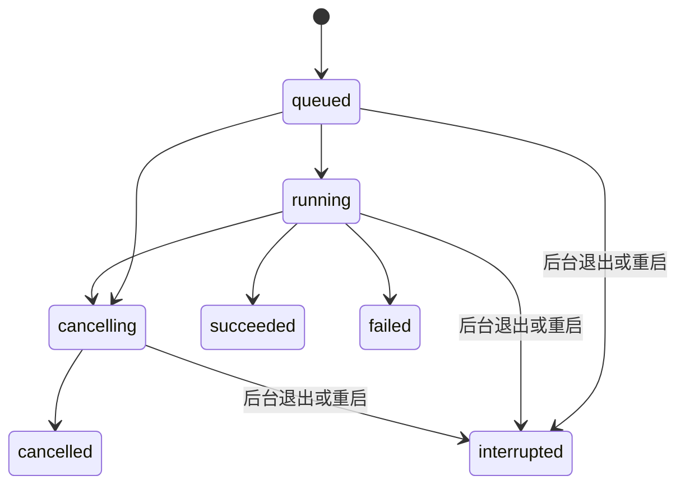

# M3 步骤 6：任务服务与实际配置

2026-09-21。当前为 **替身验证模式**，不发送真实模型请求。真实运行留到步骤 7；M3 尚未整体验收，分支保留 `feat/m3-pocketflow-runner`。

## 1. 启动和操作

前后台启动命令见 [根 README](../README.md)。后台使用 `server/.venv`，PocketFlow 另有 `server/pocketflow/.venv`，安装、来源和版本见 [依赖说明](../server/pocketflow/README.md)。

1. 打开 http://127.0.0.1:5173/ ，扫描 PocketFlow 或打开已保存项目。
2. 运行窗口选择已登记目录、中文／English、1–10 个主题。页面提供 1／3／5／10，API 接受该范围内整数。
3. 选择成功、失败或慢速替身情境，点击“启动替身任务”。慢速情境用来检查取消；主题数和语言写入记录，但固定输出不代表对应数量的真实章节。
4. 查看阶段和日志；成功后打开 Markdown、切换章节或下载。刷新后从运行历史重开。失败、取消、中断不提供成功产物。

实际配置只有 `REPOLENS_DATA_DIR`（后台绝对数据目录）与 `REPOLENS_API_PROXY`（Vite 后台代理，默认 8000）。后台默认任务超时 **180 秒**，在 `Runner` 中固定；当前没有真实运行模式环境开关，也不读取模型密钥。`GET /api/runner` 返回 `mode=stub, real_enabled=false`。

本地单用户、单后台进程、每个数据目录最多一个活动任务。已有活动任务时新建返回 409；没有持久队列调度。不要加 `--workers` 或并行启动两个后台共用一个数据库；数据目录锁会拒绝第二个拥有者。默认只监听回环地址，不是公开服务。

## 2. 调用与保存

```text
页面参数 → 校验 snapshot_id / scope → SQLite runs
       → 从登记快照按 size + SHA-256 校验并复制输入
       → 固定替身参数数组 → 监督进程 + 子进程
       → 阶段 / run.log → 产物检查 → artifacts + succeeded 同一事务
```

每次运行：

```text
var/runs/<run-id>/
├── input/                    已校验输入副本，仅选定 scope
├── home/                     独立 HOME
├── run.log                   UTF-8 合并标准输出／错误
└── output/project/
    ├── index.md
    ├── 01-introduction.md
    ├── folder-claims.json    固定替身引用（有意包含不存在文件）
    └── verified-claims.json  引用匹配结果
```

SQLite 迁移 `003_runs.sql` 增加 `runs` 与 `artifacts`，不改写 001／002。任务保存快照 ID、语言、主题数、范围、替身情境、模式、入口 Commit、阶段、时间、状态、退出码、错误。产物保存相对路径、字节数、SHA-256；原始内容留在 `var/`，本步不提交运行数据。

分析对象只能来自已登记快照与目录。调用不用 shell，用户不能提供可执行文件、命令、绝对输入路径、输出目录、模型参数或真实模式。准备中的 PocketFlow 参数数组为：

```text
server/pocketflow/.venv/bin/python -B -u <固定上游>/main.py
  --dir <本次运行>/input --name project --output <本次运行>/output
  --language Chinese|English --max-abstractions 1..10 --no-cache
```

步骤 6 只对该真实入口做 `--help` 验证；任务服务当前固定选择替身入口。步骤 7 还需接通实际服务商配置、真实阶段输出解析，以及职责提示词调用与其结果文件；本步已建立模板与引用校验，尚未实际调用提示词。

## 3. 状态和中断



六阶段对应 FetchRepo、IdentifyAbstractions、AnalyzeRelationships、OrderChapters、WriteChapters、CombineTutorial；固定替身输出带标记行。`preparing` 表示快照校验，成功后为 `complete`。这些是替身进度，不能用作真实模型管线成功证据。

取消先记 cancelling，再向进程组发送 SIGTERM，0.2 秒后对仍存活的进程组升级 SIGKILL；完成后记 cancelled。监督进程检查后台父进程，每 0.1 秒检查一次；后台强制终止会停止所属进程组。正常关闭将活动任务记 interrupted；下一次启动也将遗留 queued/running/cancelling 标记 interrupted，保留日志，不自动续跑。失败、取消、中断不会登记成功产物。已成功任务取消为幂等读取，不撤销产物。

## 4. API 合约

创建／取消属于写操作，校验本机 Origin；创建必须 JSON，请求上限 16 KiB。ID 为 UUID；时间为 UTC ISO 8601。错误格式沿用 `{detail:{code,message}}`。

| 方法与路径 | 参数 | 响应 |
|---|---|---|
| GET `/api/runner` | 无 | `{mode,real_enabled,message,timeout_seconds}` |
| POST `/api/runs` | `{snapshot_id,scope:".",language:"zh",topics:3,scenario:"success"}`，除 snapshot_id 外均有默认值 | 201 Run |
| GET `/api/runs` | 必填 snapshot_id；limit 1–100 默认20；offset≥0 默认0 | `{items:Run[],total,limit,offset}`，创建时间倒序 |
| GET `/api/runs/{id}` | 无 | Run |
| POST `/api/runs/{id}/cancel` | 无请求体 | 200 Run（包括已终止任务） |
| GET `/api/runs/{id}/logs` | offset 字节偏移≥0 默认0 | `{offset,next_offset,content,finished}` |
| GET `/api/runs/{id}/artifacts/{artifact_id}` | download=false 默认 | `{path,content,sha256,mode}` |
| 同上 `?download=true` | 无 | UTF-8 原始文件，以附件下载，octet-stream + nosniff + CSP sandbox |

Run 字段：`id,snapshot_id,mode,status,stage,language,topics,scope,scenario,created_at,started_at,ended_at,exit_code,error,upstream_commit,artifacts`。started_at／ended_at／exit_code／error 可为 null。Artifact：`id,run_id,path,size_bytes,sha256`。

常见错误：422 非法参数／目录；404 快照、任务或产物不存在；409 runner_busy、未成功的产物请求、丢失或修改的产物；403 跨来源写入；413 请求过大。真实模式字段、任意 command 等额外字段被拒绝。

日志单次读取约 32 KiB，不截断 UTF-8 字符，客户端使用 next_offset；总日志≤256 KiB，超限终止任务。产物仅登记 Markdown／JSON，单个≤512 KiB，总量≤4 MiB，最多32个；拒绝符号链接，读取前再校验 size/SHA-256。主 index.md 缺失、非零退出码、超时、输入变化或产物不合格都导致失败。

## 5. 预览与职责引用

- React 使用锁定的 `react-markdown 10.1.0`，`skipHtml`，没有 `rehype-raw`；远程图片不加载，外部和危险链接不启用。本次结果中的已登记相对 Markdown 章节链接映射为内部切换。
- `server/app/prompts/folder-responsibility-v1.md` 纳入版本管理。输出须含目录、说明、文件路径、起止行和逐字引用。
- `claims.py` 对同一快照已登记文件检查路径、哈希、行号和引用原文。引用完整匹配仍标“推断”，不能说明语义判断已正确；引用缺失／不匹配标“待核实”。结果与 M2 静态事实分开，不覆盖原始证据。
- 原始 Markdown 下载可能保留文字形式的 HTML，页面不执行；下载以附件返回。

## 6. 验证与剩余工作

本步实际验证和截图见 [步骤 6 记录](../evidence/m3/step-6-check.md)。真实模型配置、真实输出质量、提供商失败处理和一次小范围真实生成验收属于步骤 7，本步没有验证它们。

实现参考：[Python asyncio subprocess](https://docs.python.org/3/library/asyncio-subprocess.html)、[react-markdown 的安全与 HTML 处理](https://github.com/remarkjs/react-markdown#security)。
