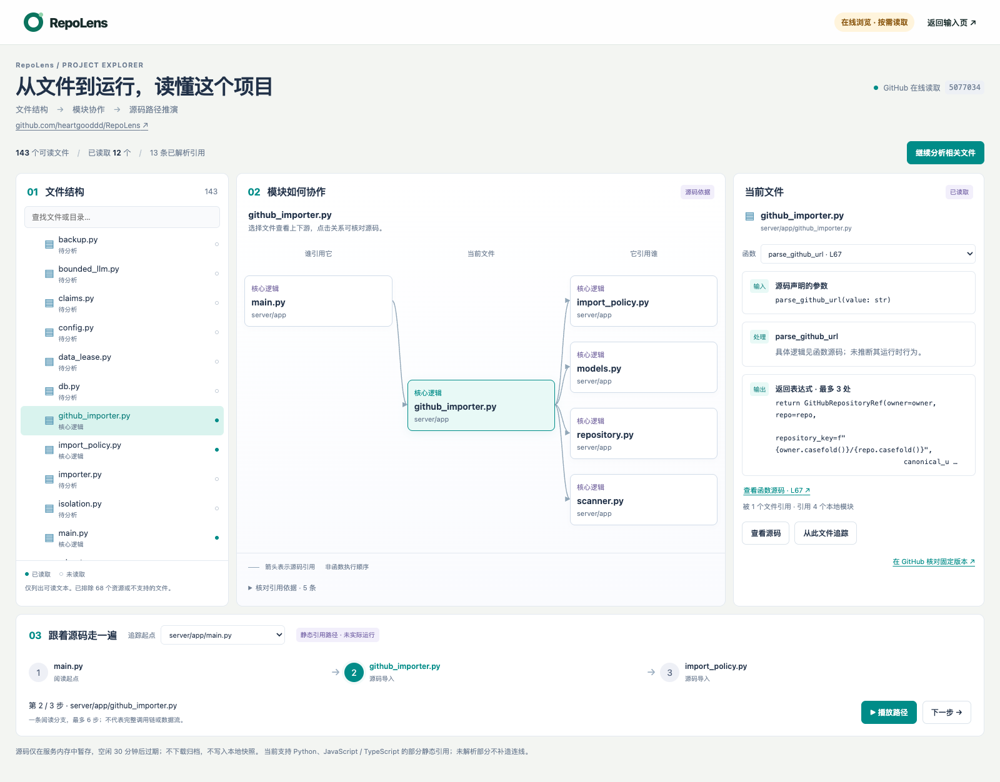
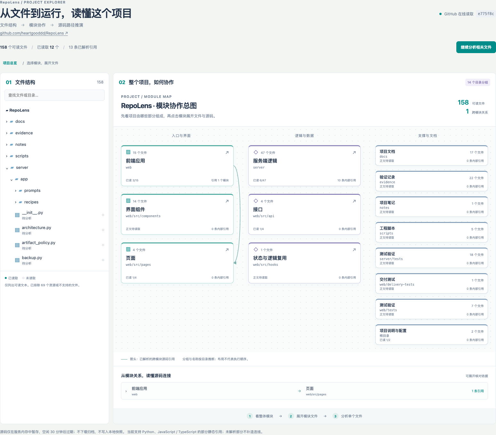
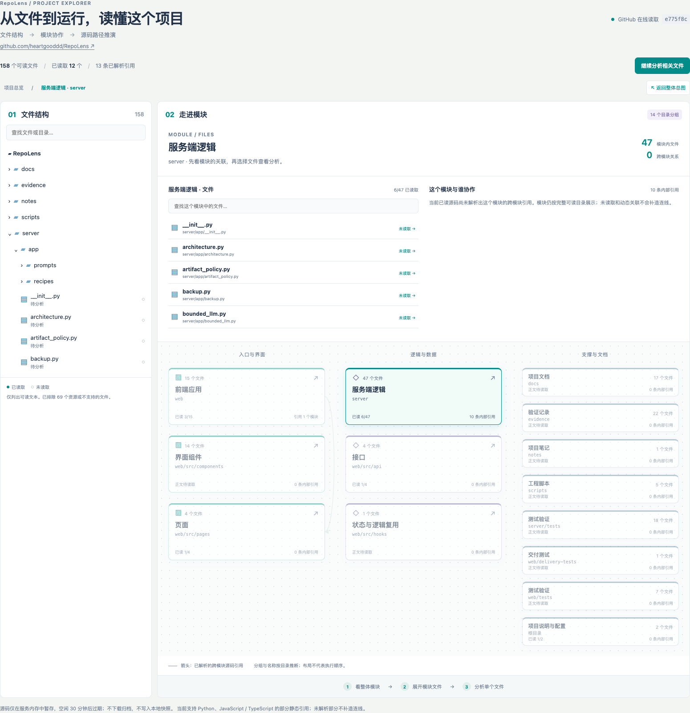

# 在线可视化工作台

状态：已实现。首次上线范围是文件结构、静态引用关系、Python 函数签名与返回表达式，以及联动阅读路径。界面中的播放是源码路径推演，不执行被分析仓库，不声称恢复了真实运行调用链。

## 使用

1. 首页默认选择「在线浏览 · 不保存源码」，输入公开 GitHub 仓库 URL。
2. 后台确定默认分支的 Commit，读取目录。页面先展示目录，再自动按优先级读取最多 12 个关键文件。
3. 点击「继续分析相关文件」分批补全内容；也可直接在树中选择未读文件，点击「读取并分析此文件」。实心标记表示已读，空心标记表示仅有目录信息。
4. 默认打开「项目总览」：左侧保留全部可读文件目录，右侧展示整体模块图，不自动选中文件。模块按完整目录与命名规则分组，未读模块也显示，并标明读取进度。点击模块，先看模块内文件和跨模块引用；点击文件后，才进入单文件分析。面包屑可返回所属模块，「返回整体总图」回到项目全貌。
5. 单文件分析显示谁引用它、它引用谁。每侧最多显示 4 个邻居，完整关系及证据在图下方展开。
6. 对 Python 文件，右侧可选择函数，查看源码中的参数和返回表达式，并跳到实际行号。每文件最多展示前 12 个函数，每函数最多展示 3 个不同返回表达式；长表达式明确以省略号截断。表达式不是运行结果；嵌套函数的返回值不会混入外层函数。
7. 单文件视图底部选择阅读起点，点击「下一步」或「播放路径」。文件树、关系图、详情同步定位。路径沿已解析引用选取一个分支，最多 6 步，避开循环，不代表完整调用链。
8. 页面刷新默认返回项目总览，可重新进入同一在线会话。空闲 30 分钟、内存容量回收或服务重启后，会提示重新打开仓库。

原有「保存快照 · 可离线重开」仍可选择。已保存项目也使用新工作台；「快照详情与运行」保留源码分页、历史产物和已登记的运行配方。在线会话不参与运行配方，也不自动保存成快照。

## 在线读取设计

- 固定来源：GitHub REST API，`GET /repos/{owner}/{repo}`、`/commits/{branch}`、`/git/trees/{commit}?recursive=1`、`/git/blobs/{sha}`。
- 目录来自一个 Commit，正文只按该目录中记录的 blob SHA 获取；内容按 Git blob SHA-1 规则校验，源码接口另返回 SHA-256。
- 不使用 clone、归档下载或工作区文件写入。在线服务只持有内存字典；已有应用的数据库、历史快照机制保持独立。
- 文本范围继承导入过滤规则：排除凭据、依赖、构建产物、链接、子模块、非支持文本及大文件。界面显示的是可读文本目录，不宣称包含仓库所有资源。
- 本轮支持最大 20,000 个目录条目。GitHub 返回 `truncated=true` 时明确拒绝，而不把截断列表当完整目录。
- 每文件最大 1 MiB，每会话最多 120 个已读文件 / 8 MiB 正文，最多 8 个内存会话。批量最多 12 个文件，45 秒读取预算，保留已完成进度；用户可重试。
- 空闲会话在下一次会话访问/创建时清理；达到会话数量上限时回收最早使用的非活动会话。
- API 限流/超时/文件校验错误有明确提示，不回退到归档下载。可在**服务进程环境**中设置 `REPOLENS_GITHUB_TOKEN` 提高 API 额度；令牌只发送到固定 GitHub API 主机，不下发浏览器或写入源码。
- POST 接口沿用本地 Origin 校验、JSON 类型校验和 16 KiB 请求体上限。

## API

| 方法 | 路径 | 作用 |
| --- | --- | --- |
| POST | `/api/online` | `{repository_url}`；创建或复用同 Commit 的在线目录会话 |
| GET | `/api/online/{id}` | 获取目录、已读状态、静态图和警告 |
| POST | `/api/online/{id}/read` | `{paths: []}` 读取下一批；明确 paths 时仅读取指定文件 |
| GET | `/api/online/{id}/source?path=...&start=1&limit=80` | 读取固定 blob 并返回有边界的源码切片 |

`architecture` 的分析范围仅含已读源码。目录文件总数与已读数分开显示。404 表示来源/文件不可访问，410 表示会话失效，413 表示容量/目录上限，429 表示 GitHub 限流。

## 当前分析边界

Python 使用 AST 提取定义、导入、签名和返回表达式；JavaScript/TypeScript 的本地引用沿用已有扫描器。动态导入、部分路径别名、反射、外部服务调用及运行时条件不能保证恢复。模块类别按名称归类时仍标明推断。未使用模型补造职责、业务场景或数据流。

因此，当前版本交付的是可操作的代码阅读工作台；任意业务场景的自动语义理解，以及真实输入输出的运行回放仍需后续独立实现。

## 验证

```bash
# 仓库根目录；完整导入回归需要 Install.command 提供的固定 PocketFlow 样本
server/.venv/bin/python -m pytest server/tests/test_online.py server/tests/test_architecture.py server/tests/test_api.py server/tests/test_import.py server/tests/test_storage.py server/tests/test_github_import.py -q

# web/ 目录
npm run build
npx playwright test --config playwright.explorer.config.ts
npx playwright test tests/repository.spec.ts tests/runner.spec.ts --config playwright.config.ts
```

`playwright.explorer.config.ts` 启动真实后端和真实分析器，仅将 GitHub 网络替换为离线 fixture，覆盖桌面/窄屏、未读文件、限流重试、源码证据、路径播放、刷新/过期及快照兼容。不调用收费模型。

## 本次验收记录（2026-10-14）

- 前端 TypeScript 检查及生产构建通过。
- 上述后端回归集：70 passed；最后的函数摘录调整后，在线读取与架构专项 10 passed。
- 在线/地图/导入浏览器集：16 passed；快照和运行入口兼容集：10 passed，均包含桌面与窄屏。最后的文件树自动定位调整后，在线专项 6 passed。
- 真实网络读取 `heartgooddd/RepoLens` 的 `5077034dee9eb1da44368afa5c977d5aaf3a6272`：143 个可读文本文件，按需读取 12 个，解析出 13 条静态引用，无读取警告。**这是部分读取验收，不是全仓库分析完成。**
- 真实浏览器检查 320、390、768、1100、1600 像素宽度，无页面横向溢出、无浏览器脚本错误。匿名 API 限流和已读取进度保留也经过实测。
- 未执行导入源码，未调用收费模型，未重新做 M6 全量交付或真实用户试用。



## 总览优先改进（2026-10-14）

- 阅读层级调整为「整体模块总图 → 模块内文件 → 单文件分析」，在线会话与已保存快照共用。继续读取文件只更新覆盖数和关系，不自动进入单文件。
- 分组只依赖目录与文件名，读取新批次不会改变分组 ID；保留每个文件的唯一归属。应用基础目录合并，页面、组件、接口等命名领域单列；文档、测试等以紧凑卡片展示。分类是推断，不声称恢复业务语义。
- 跨模块箭头聚合已解析的文件引用，并保留方向、引用数量和原始行号证据；模块内部引用单独计数。包含关系、未知目标和未解析行为不会生成协作箭头。图中按类别排布，不表示执行顺序。
- 超过 18 个分组时，提供「展开全部」入口；模块文件列表最多展示 100 个匹配项，可搜索其余文件。全量目录始终可在左侧查找。
- 验证：生产构建和类型检查通过；22 项测试通过（16 项桌面/窄屏交互回归，3 项分组与引用聚合测试在两种配置各跑一次）。覆盖默认总览、模块下钻、文件分析、返回总览、刷新、未读模块、源码证据和原工作台入口。最后的辅助卡片间距和侧边窗口适配后，再次完成构建、6 项交互回归与真实页面截图检查；828 像素侧边窗口内可直接看见三列模块。
- 真实在线验证：`heartgooddd/RepoLens` 固定版本 `e775f8c92aa31e3ac2da77a1cf002a1c3e105967`，158 个可读文件，已读 12 个，14 个模块分组，13 条文件引用聚合出 1 条跨模块关系（其余在模块内部）。这是部分读取结果；无连线不表示模块不协作。320、390、768、1100、1600 像素下无页面横向溢出、无脚本错误。
- 同时检查已有 PocketFlow 快照的「总图 → 通用工具 → call_llm.py」路径。后端本轮无改动，未重复执行上一轮的后端验收集。




