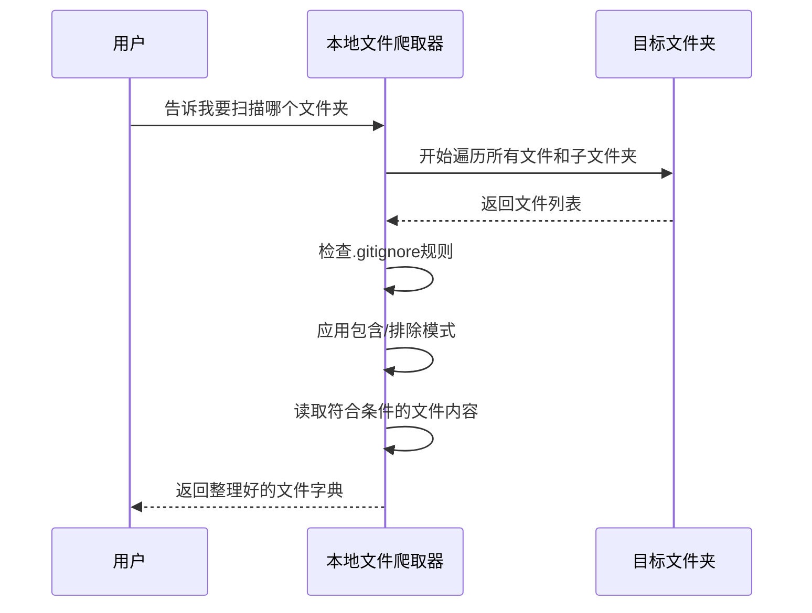

# Chapter 1: 本地文件爬取器


欢迎来到本教程的第一章！今天我们要认识一个非常实用的工具——**本地文件爬取器**。你可以把它想象成一个智能的“文件管家”，它能帮你自动扫描电脑上的文件夹，找出所有你需要的文件，并把它们的内容整理好送给你。

## 为什么要用这个工具？

想象一下这个场景：你接手了一个别人写的项目，里面有几十个文件夹、几百个文件。你想快速了解这个项目的代码结构，看看哪些文件是核心代码，哪些是配置文件。如果手动一个一个打开文件查看，那得花多少时间啊！

这时候，本地文件爬取器就派上用场了。你只需要告诉它：
- 要扫描哪个文件夹
- 想看什么类型的文件（比如只看 `.py` 文件）
- 想跳过哪些文件（比如临时文件）

它就会自动帮你完成所有工作，最后给你一份清晰的清单：每个文件的路径和内容。

## 核心概念

这个工具虽然功能强大，但核心概念其实很简单，只有三个：

### 1. 扫描目录（directory）
这是你要“搜查”的文件夹路径。比如你的项目文件夹 `D:/my_project`。

### 2. 包含模式（include_patterns）
你想看哪些文件？可以指定文件类型，比如 `{"*.py", "*.js"}` 表示只看 Python 和 JavaScript 文件。

### 3. 排除模式（exclude_patterns）
你想跳过哪些文件？比如 `{"*.pyc", "__pycache__/*"}` 表示跳过编译文件和缓存文件夹。

## 如何使用？

让我们用一个实际例子来演示。假设你有一个项目文件夹，里面包含以下文件：

```
my_project/
├── main.py
├── utils.py
├── config.json
├── __pycache__/
│   └── main.cpython-39.pyc
└── .gitignore
```

你想扫描这个文件夹，只看 `.py` 文件，跳过 `__pycache__` 文件夹。代码如下：

```python
from crawl_local_files import crawl_local_files

# 扫描当前目录的父目录（..）
result = crawl_local_files(
    directory="..",  # 要扫描的文件夹
    include_patterns={"*.py"},  # 只看Python文件
    exclude_patterns={"__pycache__/*"}  # 跳过缓存文件夹
)
```

**这段代码做了什么？**
- `directory=".."`：告诉爬取器扫描当前文件夹的父目录
- `include_patterns={"*.py"}`：只关心 `.py` 结尾的文件
- `exclude_patterns={"__pycache__/*"}`：跳过 `__pycache__` 文件夹里的所有文件

运行后，你会看到类似这样的输出：

```
Progress: 1/3 (33%) main.py [processed]
Progress: 2/3 (66%) utils.py [processed]
Progress: 3/3 (100%) config.json [skipped (excluded)]
```

最终 `result` 会是一个字典，包含所有被处理的文件：

```python
{
    "files": {
        "main.py": "print('Hello')",
        "utils.py": "def add(a, b): return a + b"
    }
}
```

## 内部工作原理

现在让我们看看这个工具内部是怎么工作的。下面是一个简单的流程图：



### 步骤详解

1. **检查文件夹是否存在**：首先确认你给的路径确实是一个文件夹
2. **加载 .gitignore**：如果文件夹里有 `.gitignore` 文件，自动读取里面的规则
3. **遍历所有文件**：使用 `os.walk` 递归地访问每个子文件夹
4. **过滤文件**：根据包含/排除模式决定哪些文件要保留
5. **读取文件内容**：打开符合条件的文件，读取里面的文字
6. **返回结果**：把所有文件路径和内容打包成一个字典

## 代码深度解析

让我们看看核心代码是怎么实现的。为了便于理解，我把代码简化成几个关键部分：

### 第一步：检查文件夹

```python
import os

def crawl_local_files(directory):
    # 检查文件夹是否存在
    if not os.path.isdir(directory):
        raise ValueError(f"文件夹不存在: {directory}")
```

**解释**：这就像你告诉管家“去打扫客厅”，管家会先确认客厅确实存在。如果不存在，就会报错。

### 第二步：加载 .gitignore

```python
import pathspec

# 尝试加载.gitignore文件
gitignore_path = os.path.join(directory, ".gitignore")
if os.path.exists(gitignore_path):
    with open(gitignore_path, "r") as f:
        patterns = f.readlines()
    gitignore_spec = pathspec.PathSpec.from_lines("gitwildmatch", patterns)
```

**解释**：`.gitignore` 文件里写着哪些文件应该被 Git 忽略。我们的爬取器也会尊重这些规则，自动跳过被忽略的文件。

### 第三步：遍历文件并过滤

```python
import fnmatch

for root, dirs, files in os.walk(directory):
    for filename in files:
        filepath = os.path.join(root, filename)
        relpath = os.path.relpath(filepath, directory)
        
        # 检查是否应该排除
        if exclude_patterns:
            for pattern in exclude_patterns:
                if fnmatch.fnmatch(relpath, pattern):
                    continue  # 跳过这个文件
```

**解释**：`os.walk` 就像一个自动导航仪，它会走进每个子文件夹，把里面的文件一个一个列出来。然后我们用 `fnmatch` 来检查文件名是否匹配排除模式。

### 第四步：读取文件内容

```python
try:
    with open(filepath, "r", encoding="utf-8-sig") as f:
        content = f.read()
    files_dict[relpath] = content
except Exception as e:
    print(f"警告: 无法读取文件 {filepath}: {e}")
```

**解释**：对于符合条件的文件，我们尝试用 UTF-8 编码打开并读取内容。如果文件是二进制文件或者编码有问题，会跳过并打印警告。

## 进阶技巧

### 限制文件大小

如果你的项目里有很大的文件（比如日志文件），可以设置最大文件大小：

```python
result = crawl_local_files(
    directory="..",
    max_file_size=1024 * 1024,  # 只读取小于1MB的文件
    exclude_patterns={"*.log"}
)
```

### 使用相对路径

默认情况下，返回的文件路径是相对于扫描目录的。如果你想用绝对路径，可以设置：

```python
result = crawl_local_files(
    directory="..",
    use_relative_paths=False  # 使用绝对路径
)
```

## 总结

恭喜你完成了第一章的学习！现在你已经掌握了本地文件爬取器的基本用法。这个工具能帮你：
- ✅ 快速扫描本地文件夹
- ✅ 按文件类型筛选文件
- ✅ 自动跳过不需要的文件
- ✅ 尊重 `.gitignore` 规则
- ✅ 返回整理好的文件内容

下一章我们将学习如何从远程仓库获取文件，也就是 **远程仓库文件爬取器**。它会让你能够直接从 GitHub 等平台获取代码，非常方便！

继续学习：[第二章：远程仓库文件爬取器](02_远程仓库文件爬取器_.md)

---

Generated by [AI Codebase Knowledge Builder](https://github.com/The-Pocket/Tutorial-Codebase-Knowledge)