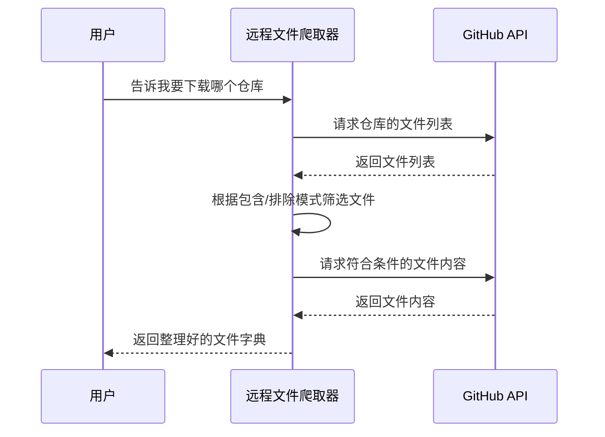

# Chapter 2: 远程仓库文件爬取器


欢迎来到第二章！在[第一章：本地文件爬取器](01_本地文件爬取器_.md)中，我们学会了如何扫描自己电脑上的文件夹。但很多时候，我们需要的文件并不在本地，而是在 GitHub 这样的远程仓库里。比如，你想研究一个开源项目，或者想从公司的私有仓库里下载代码，该怎么办呢？

这时候，**远程仓库文件爬取器**就派上用场了！它就像一个智能的“远程文件快递员”，你只需要告诉它仓库的地址和要下载的路径，它就能自动从 GitHub 上把文件取回来。

## 为什么要用这个工具？

想象一下这个场景：你在 GitHub 上发现了一个很棒的开源项目，比如 `pydantic`，你想看看它的核心代码是怎么写的。但是，这个项目有几十个文件夹、几百个文件，手动一个一个下载太麻烦了。

更麻烦的是，有些仓库是私有的，需要权限才能访问；有些仓库很大，下载速度很慢；还有些仓库有访问频率限制，下载几个文件就被限制了。

这时候，远程仓库文件爬取器就能帮你解决这些问题：
- ✅ 自动从 GitHub 下载文件
- ✅ 支持公开和私有仓库
- ✅ 按文件类型筛选（比如只看 `.py` 文件）
- ✅ 自动处理访问频率限制
- ✅ 支持 SSH 和 HTTPS 两种协议

## 核心概念

这个工具虽然功能强大，但核心概念其实很简单，只有四个：

### 1. 仓库地址（repo_url）
这是你要下载的 GitHub 仓库的地址。比如：
```
https://github.com/pydantic/pydantic/tree/main/pydantic
```
这个地址包含了仓库的所有者（`pydantic`）、仓库名（`pydantic`）、分支（`main`）和路径（`pydantic`）。

### 2. 访问令牌（token）
如果你要访问私有仓库，或者想避免公开仓库的访问频率限制，就需要提供一个 GitHub 个人访问令牌。这就像一把“钥匙”，让你有权限进入仓库。

### 3. 包含模式（include_patterns）
你想看哪些文件？可以指定文件类型，比如 `{"*.py", "*.md"}` 表示只看 Python 和 Markdown 文件。

### 4. 排除模式（exclude_patterns）
你想跳过哪些文件？比如 `{"*test*"}` 表示跳过所有测试文件。

## 如何使用？

让我们用一个实际例子来演示。假设你想从 `pydantic` 仓库下载所有 Python 和 Markdown 文件，但跳过测试文件。代码如下：

```python
from crawl_github_files import crawl_github_files

# 设置仓库地址
repo_url = "https://github.com/pydantic/pydantic/tree/main/pydantic"

# 下载文件
result = crawl_github_files(
    repo_url=repo_url,
    include_patterns={"*.py", "*.md"},  # 只看 Python 和 Markdown 文件
    exclude_patterns={"*test*"}  # 跳过测试文件
)
```

**这段代码做了什么？**
- `repo_url=repo_url`：告诉爬取器要访问哪个仓库
- `include_patterns={"*.py", "*.md"}`：只关心 `.py` 和 `.md` 结尾的文件
- `exclude_patterns={"*test*"}`：跳过文件名包含 `test` 的文件

运行后，你会看到类似这样的输出：

```
Downloaded: pydantic/main.py (1024 bytes)
Downloaded: pydantic/utils.py (2048 bytes)
Downloaded: pydantic/README.md (512 bytes)
Skipping: pydantic/test_main.py (does not match include/exclude patterns)
```

最终 `result` 会是一个字典，包含所有下载的文件：

```python
{
    "files": {
        "pydantic/main.py": "print('Hello')",
        "pydantic/utils.py": "def add(a, b): return a + b",
        "pydantic/README.md": "# Pydantic"
    },
    "stats": {
        "downloaded_count": 3,
        "skipped_count": 1
    }
}
```

## 内部工作原理

现在让我们看看这个工具内部是怎么工作的。下面是一个简单的流程图：



### 步骤详解

1. **解析仓库地址**：首先分析你给的 URL，提取出仓库的所有者、仓库名、分支和路径
2. **获取文件列表**：使用 GitHub API 获取指定路径下的所有文件和文件夹
3. **筛选文件**：根据包含/排除模式决定哪些文件要下载
4. **下载文件内容**：对于符合条件的文件，逐个下载它们的内容
5. **处理访问限制**：如果遇到访问频率限制，自动等待一段时间再重试
6. **返回结果**：把所有文件路径和内容打包成一个字典

## 代码深度解析

让我们看看核心代码是怎么实现的。为了便于理解，我把代码简化成几个关键部分：

### 第一步：解析仓库地址

```python
from urllib.parse import urlparse

# 解析 GitHub URL
parsed_url = urlparse(repo_url)
path_parts = parsed_url.path.strip('/').split('/')

# 提取所有者、仓库名
owner = path_parts[0]  # 比如 "pydantic"
repo = path_parts[1]   # 比如 "pydantic"
```

**解释**：这就像你告诉快递员“去北京市朝阳区某某小区”，快递员会先分析这个地址，找出城市、区域和具体位置。

### 第二步：获取文件列表

```python
import requests

# 设置请求头
headers = {"Accept": "application/vnd.github.v3+json"}
if token:
    headers["Authorization"] = f"token {token}"

# 请求文件列表
url = f"https://api.github.com/repos/{owner}/{repo}/contents/{path}"
response = requests.get(url, headers=headers)
```

**解释**：这就像快递员到了小区，先问保安“这个小区有哪些楼栋？”。GitHub API 会返回一个文件列表，告诉我们有哪些文件和文件夹。

### 第三步：筛选文件

```python
import fnmatch

def should_include_file(file_path, file_name):
    """判断文件是否应该被包含"""
    # 如果没有指定包含模式，就包含所有文件
    if not include_patterns:
        return True
    
    # 检查文件名是否匹配包含模式
    for pattern in include_patterns:
        if fnmatch.fnmatch(file_name, pattern):
            return True
    
    return False
```

**解释**：这就像快递员拿着你的购物清单，只取清单上的物品。`fnmatch.fnmatch` 就像一个智能匹配器，能识别 `*.py` 这样的模式。

### 第四步：下载文件内容

```python
# 对于每个符合条件的文件
for item in contents:
    if item["type"] == "file":
        # 获取文件的下载地址
        file_url = item["download_url"]
        
        # 下载文件内容
        file_response = requests.get(file_url)
        
        # 保存文件内容
        files[item["path"]] = file_response.text
```

**解释**：这就像快递员找到你的包裹后，把它取出来交给你。每个文件都有一个 `download_url`，直接访问这个地址就能下载文件内容。

### 第五步：处理访问频率限制

```python
import time

# 如果遇到访问频率限制
if response.status_code == 403:
    # 获取重置时间
    reset_time = int(response.headers.get('X-RateLimit-Reset', 0))
    wait_time = max(reset_time - time.time(), 0) + 1
    
    print(f"访问频率限制，等待 {wait_time} 秒...")
    time.sleep(wait_time)
    
    # 重新请求
    return fetch_contents(path)
```

**解释**：GitHub 对 API 访问有频率限制，就像超市里每个顾客只能买一定数量的商品。如果超过了限制，我们的爬取器会自动等待一段时间再重试。

## 进阶技巧

### 访问私有仓库

如果你要访问私有仓库，需要提供 GitHub 个人访问令牌：

```python
# 从环境变量获取令牌
github_token = os.environ.get("GITHUB_TOKEN")

result = crawl_github_files(
    repo_url="https://github.com/your-company/private-repo",
    token=github_token  # 提供访问令牌
)
```

### 使用 SSH 协议

有些仓库使用 SSH 协议，爬取器也支持：

```python
result = crawl_github_files(
    repo_url="git@github.com:username/repo.git",
    token=github_token
)
```

### 限制文件大小

如果仓库里有很大的文件，可以设置最大文件大小：

```python
result = crawl_github_files(
    repo_url=repo_url,
    max_file_size=1024 * 1024,  # 只下载小于1MB的文件
    include_patterns={"*.py"}
)
```

## 总结

恭喜你完成了第二章的学习！现在你已经掌握了远程仓库文件爬取器的基本用法。这个工具能帮你：
- ✅ 从 GitHub 仓库自动下载文件
- ✅ 按文件类型筛选文件
- ✅ 自动跳过不需要的文件
- ✅ 处理访问频率限制
- ✅ 支持公开和私有仓库

下一章我们将学习如何与大型语言模型（LLM）交互，也就是 **LLM调用器**。它会让你能够轻松地调用各种 AI 模型，非常有趣！

继续学习：[第三章：LLM调用器](03_llm调用器_.md)

---

Generated by [AI Codebase Knowledge Builder](https://github.com/The-Pocket/Tutorial-Codebase-Knowledge)