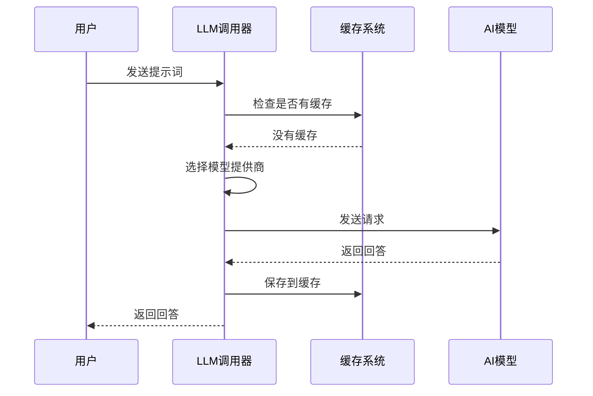

# Chapter 3: LLM调用器


欢迎来到第三章！在[第二章：远程仓库文件爬取器](02_远程仓库文件爬取器_.md)中，我们学会了如何从 GitHub 这样的远程仓库下载文件。现在，我们已经有了代码文件的内容，但光有代码还不够——我们还需要理解它、分析它，甚至让它帮我们写代码！

这时候，**LLM调用器**就闪亮登场了！它就像一个“万能遥控器”，能让你轻松地跟各种大语言模型（比如 Gemini、Ollama、XAI）对话。你只需要告诉它“帮我解释这段代码”，它就会自动找到合适的模型，发送请求，然后把结果返回给你。

## 为什么要用这个工具？

想象一下这个场景：你从 GitHub 下载了一个开源项目的代码，但里面有很多复杂的函数和类，你看不太懂。你想让 AI 帮你解释一下，但每个 AI 模型都有自己的 API 地址、认证方式和调用格式。如果每次都要手动配置，那得多麻烦啊！

更麻烦的是，有些模型需要 API 密钥，有些不需要；有些模型在本地运行（比如 Ollama），有些在云端（比如 Gemini）。如果每次切换模型都要改代码，那简直是一场噩梦。

这时候，LLM调用器就能帮你解决这些问题：
- ✅ **统一接口**：不管用哪个模型，调用方式都一样
- ✅ **自动选择**：根据环境变量自动选择正确的模型
- ✅ **缓存机制**：重复的问题不用再问，直接返回缓存结果
- ✅ **日志记录**：每次调用都记录下来，方便调试和追踪

## 核心概念

这个工具虽然功能强大，但核心概念其实很简单，只有三个：

### 1. 提示词（prompt）
这是你要问 AI 的问题。比如：
```
"请用中文解释一下这段代码：def add(a, b): return a + b"
```

### 2. 模型提供商（provider）
这是你要使用的 AI 模型。目前支持三种：
- **Gemini**：Google 的 AI 模型，需要 API 密钥或项目 ID
- **Ollama**：本地运行的模型，不需要 API 密钥
- **XAI**：其他兼容 OpenAI 格式的模型

### 3. 缓存（cache）
为了避免重复调用 API（既费钱又费时间），工具会把每次的问答结果保存下来。如果下次问同样的问题，就直接从缓存里取答案。

## 如何使用？

让我们用一个实际例子来演示。假设你想让 AI 解释一段 Python 代码：

```python
from call_llm import call_llm

# 设置提示词
prompt = "请用中文解释一下：def add(a, b): return a + b"

# 调用 LLM
response = call_llm(prompt)

# 打印结果
print(response)
```

**这段代码做了什么？**
- `from call_llm import call_llm`：导入 LLM 调用器
- `prompt = "..."`：设置你要问的问题
- `response = call_llm(prompt)`：调用 AI 模型，获取回答
- `print(response)`：打印 AI 的回答

运行后，你会看到类似这样的输出：

```
这个函数定义了一个名为 add 的函数，它接受两个参数 a 和 b，然后返回它们的和。
```

### 使用缓存

如果你问同样的问题，第二次调用会直接从缓存返回结果，不会真的调用 API：

```python
# 第一次调用 - 会调用 API
response1 = call_llm("1+1等于几？")
print(response1)  # 输出：2

# 第二次调用 - 直接从缓存返回
response2 = call_llm("1+1等于几？")
print(response2)  # 输出：2（从缓存读取，没有调用 API）
```

### 关闭缓存

如果你不想使用缓存（比如测试时），可以设置 `use_cache=False`：

```python
response = call_llm("你好吗？", use_cache=False)
```

## 内部工作原理

现在让我们看看这个工具内部是怎么工作的。下面是一个简单的流程图：



### 步骤详解

1. **接收提示词**：你告诉调用器你想问什么
2. **检查缓存**：先看看之前有没有问过同样的问题
3. **选择模型**：根据环境变量决定用哪个 AI 模型
4. **发送请求**：把提示词发送给选中的模型
5. **获取回答**：等待模型返回结果
6. **保存缓存**：把这次的问答结果保存下来
7. **返回结果**：把 AI 的回答返回给你

## 代码深度解析

让我们看看核心代码是怎么实现的。为了便于理解，我把代码简化成几个关键部分：

### 第一步：选择模型提供商

```python
def get_llm_provider():
    # 从环境变量读取提供商
    provider = os.getenv("LLM_PROVIDER")
    
    # 如果没有设置，但配置了 Gemini，就默认用 Gemini
    if not provider and (os.getenv("GEMINI_API_KEY")):
        provider = "GEMINI"
    
    return provider
```

**解释**：这就像你有一个万能遥控器，它会先看看你设置了什么模式。如果你设置了“Gemini 模式”，它就用 Gemini；如果没设置，但你有 Gemini 的 API 密钥，它也会自动选择 Gemini。

### 第二步：调用通用模型

```python
def _call_llm_provider(prompt):
    # 从环境变量读取配置
    provider = os.environ.get("LLM_PROVIDER")
    model = os.environ.get(f"{provider}_MODEL")
    base_url = os.environ.get(f"{provider}_BASE_URL")
    api_key = os.environ.get(f"{provider}_API_KEY", "")
    
    # 构造请求地址
    url = f"{base_url}/v1/chat/completions"
    
    # 设置请求头
    headers = {"Content-Type": "application/json"}
    if api_key:
        headers["Authorization"] = f"Bearer {api_key}"
    
    # 构造请求体
    payload = {
        "model": model,
        "messages": [{"role": "user", "content": prompt}]
    }
    
    # 发送请求
    response = requests.post(url, headers=headers, json=payload)
    return response.json()["choices"][0]["message"]["content"]
```

**解释**：这段代码是调用通用模型（比如 Ollama 或 XAI）的核心。它做了三件事：
1. **读取配置**：从环境变量中读取模型名称、地址和密钥
2. **构造请求**：按照 OpenAI 的格式构造请求
3. **发送请求**：用 `requests` 库发送 HTTP 请求，并提取回答

### 第三步：调用 Gemini 模型

```python
def _call_llm_gemini(prompt):
    # 创建 Gemini 客户端
    if os.getenv("GEMINI_API_KEY"):
        client = genai.Client(api_key=os.getenv("GEMINI_API_KEY"))
    
    # 设置模型
    model = os.getenv("GEMINI_MODEL", "gemini-2.5-pro-exp-03-25")
    
    # 发送请求
    response = client.models.generate_content(
        model=model,
        contents=[prompt]
    )
    return response.text
```

**解释**：Gemini 的调用方式跟通用模型不太一样，它有自己的 SDK。这段代码：
1. **创建客户端**：用 API 密钥创建一个 Gemini 客户端
2. **设置模型**：选择要使用的 Gemini 模型版本
3. **发送请求**：调用 Gemini 的 API 并返回回答

### 第四步：缓存系统

```python
def load_cache():
    # 从文件加载缓存
    try:
        with open("llm_cache.json", 'r') as f:
            return json.load(f)
    except:
        return {}

def save_cache(cache):
    # 保存缓存到文件
    try:
        with open("llm_cache.json", 'w') as f:
            json.dump(cache, f)
    except:
        pass
```

**解释**：缓存系统就像一个“小本本”，它会记录每次的问答结果：
- `load_cache()`：打开小本本，看看之前记了什么
- `save_cache()`：把新的问答结果记到小本本上

### 第五步：主函数

```python
def call_llm(prompt, use_cache=True):
    # 记录日志
    logger.info(f"PROMPT: {prompt}")
    
    # 检查缓存
    if use_cache:
        cache = load_cache()
        if prompt in cache:
            return cache[prompt]
    
    # 选择模型并调用
    provider = get_llm_provider()
    if provider == "GEMINI":
        response = _call_llm_gemini(prompt)
    else:
        response = _call_llm_provider(prompt)
    
    # 保存到缓存
    if use_cache:
        cache = load_cache()
        cache[prompt] = response
        save_cache(cache)
    
    return response
```

**解释**：这是整个工具的“大脑”，它把前面所有步骤串联起来：
1. **记录日志**：把问题记下来，方便以后查看
2. **检查缓存**：如果之前问过同样的问题，直接返回答案
3. **选择模型**：根据配置选择用 Gemini 还是其他模型
4. **调用模型**：发送请求并获取回答
5. **保存缓存**：把这次的问答结果保存下来
6. **返回结果**：把 AI 的回答返回给你

## 进阶技巧

### 配置环境变量

要使用这个工具，你需要设置一些环境变量。比如，如果你想用 Ollama：

```bash
# 设置提供商为 Ollama
export LLM_PROVIDER=OLLAMA

# 设置模型名称
export OLLAMA_MODEL=llama3.2

# 设置 Ollama 的地址
export OLLAMA_BASE_URL=http://localhost:11434
```

如果你想用 Gemini：

```bash
# 设置 Gemini API 密钥
export GEMINI_API_KEY=your_api_key_here

# 设置模型名称（可选，默认用最新版）
export GEMINI_MODEL=gemini-2.5-pro-exp-03-25
```

### 查看日志

每次调用 LLM，工具都会记录日志。日志文件保存在 `logs` 文件夹里，文件名是 `llm_calls_YYYYMMDD.log`。你可以打开看看：

```
2025-01-15 10:30:00 - INFO - PROMPT: 请用中文解释一下：def add(a, b): return a + b
2025-01-15 10:30:02 - INFO - RESPONSE: 这个函数定义了一个名为 add 的函数...
```

### 清空缓存

如果你想清空缓存，只需要删除 `llm_cache.json` 文件：

```bash
rm llm_cache.json
```

## 总结

恭喜你完成了第三章的学习！现在你已经掌握了 LLM 调用器的基本用法。这个工具能帮你：
- ✅ **统一调用**：不管用哪个 AI 模型，调用方式都一样
- ✅ **自动选择**：根据环境变量自动选择正确的模型
- ✅ **缓存机制**：重复的问题不用再问，节省时间和费用
- ✅ **日志记录**：每次调用都记录下来，方便调试

现在，你已经学会了如何从本地和远程获取代码，以及如何让 AI 帮你理解代码。下一章，我们将学习如何把这些工具组合起来，构建一个完整的代码分析工具！

继续学习：[第四章：代码分析器](04_代码分析器_.md)

---

Generated by [AI Codebase Knowledge Builder](https://github.com/The-Pocket/Tutorial-Codebase-Knowledge)