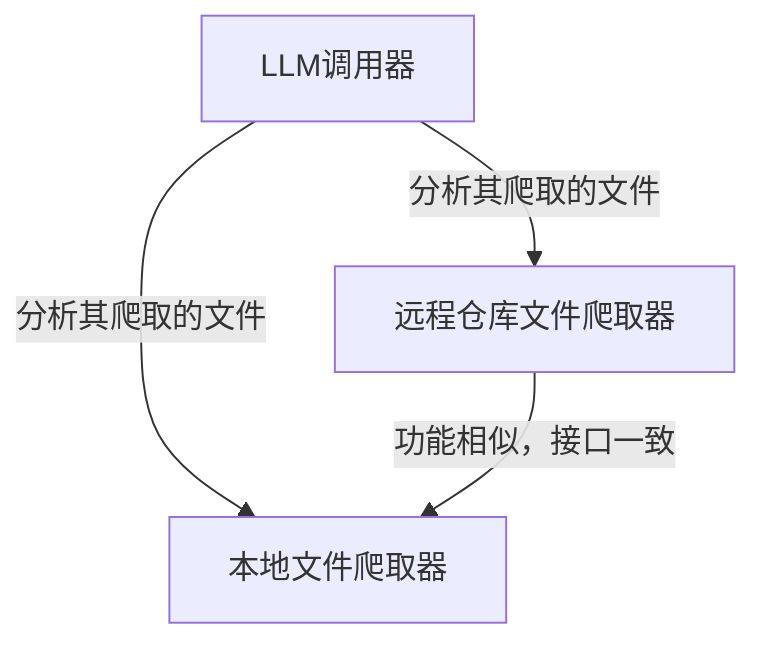

# Tutorial: project

这个项目是一个**智能代码分析工具**，它能够自动从*本地文件夹*或*远程GitHub仓库*中**爬取**代码文件，然后利用**大语言模型（LLM）** 来理解和分析这些代码。你可以把它想象成一个**超级助手**，你告诉它要看哪个项目，它就能把代码内容整理好，并调用AI来帮你解读，非常适合用来快速学习新项目或进行代码审查。

**来源快照：** `5a4a6d2b-049f-440d-8544-8c49fec62e8d` · `utils` · Commit `05b24cbbb0fe409c5e23c9791f0342f07524ffdc`

## Chapters

1. [本地文件爬取器
](01_本地文件爬取器_.md)
2. [远程仓库文件爬取器
](02_远程仓库文件爬取器_.md)
3. [LLM调用器
](03_llm调用器_.md)

---

Generated by [AI Codebase Knowledge Builder](https://github.com/The-Pocket/Tutorial-Codebase-Knowledge)